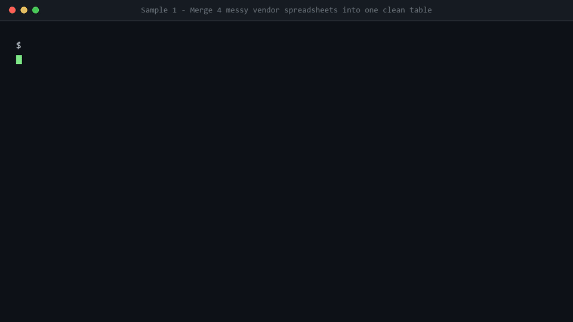

# Sample Project — Batch Spreadsheet Automation (Python)

> **Sample project — demo data, no client involved.**
> This is a self-built demonstration built for my Upwork portfolio. All company names,
> contacts, emails, phone numbers and amounts are fictional and were created only to
> exercise the script. No client work, no client data, and no client results are shown.

**What it does:** takes a folder of messy vendor spreadsheets (different column names,
different date formats, mixed currencies, duplicate rows) and produces one clean master
table plus a run summary — in about a fifth of a second.

---

## Demo (real recorded run)



---

## 1. The problem

A typical small-business spreadsheet mess looks like this, and it arrives from four
different suppliers who each export their own way:

| Source | Company column | Date column | Amount style | Currency column |
|---|---|---|---|---|
| `vendor_a_equipment.csv` | `company_name` | `order_date` | `1,234.50` | `currency` (USD/usd/$) |
| `vendor_b_services.csv` | `Vendor` | `Order Date` | `960` / `2,400.00` | `Currency` |
| `vendor_c_supply.csv` | `supplier` | `date` | `1.890,20` (EU format) | `ccy` (eur/euro) |
| `vendor_d_office_supply.xlsx` | `Company` | `Order Date` | `¥128000` | `Currency` |

Doing this by hand means, per source file:

1. Renaming columns by hand so they line up.
2. Re-typing dates that arrive in five different formats (`2024-10-01`, `2024/10/05`,
   `05.10.2024`, `Oct 2, 2024`, `12.11.2024`).
3. Working out whether `1,234.50` means one thousand two hundred or one point two — and
   whether `4.310,75` is four thousand three hundred or forty-three point one.
4. Stripping phone formatting (`+1 (415) 555-0123` → `14155550123`).
5. Spotting that the *same vendor* appears three times under three spellings
   (`Acme Industrial Ltd.`, `ACME INDUSTRIAL LTD`, `  Acme  Industrial   Ltd`).
6. Doing all of that again next week, with a slightly different mess.

That is roughly two hours of copy-paste per week for this data set.

## 2. The approach

`merge_clean.py` turns the six manual steps into one command.

```
input/*.csv + input/*.xlsx
        │
        ▼
  [1] read every CSV and XLSX in the folder (pandas)
        │
        ▼
  [2] map vendor column names → one canonical schema
        │      (alias table, e.g. "Vendor"/"supplier"/"Company" → company_name)
        ▼
  [3] clean every field
        │      dates  → ISO 8601 (YYYY-MM-DD)
        │      phones → digits only, 00-prefix stripped
        │      money  → float, EU + US separators both handled
        │      currency→ ISO code (USD/EUR/GBP/JPY/CNY), inferred from symbol if missing
        │      text   → trimmed, de-duplicated whitespace, consistent capitalisation
        ▼
  [4] merge records for the same vendor
        │      key = company (normalised) + email, falling back to phone
        │      the merge is reported, not silent: rows_combined per vendor
        ▼
  [5] write output/clean_master.csv + output/run_summary.csv
```

### Design decisions worth knowing

- **The alias table is data, not code.** `COLUMN_ALIASES` maps every header variant to a
  canonical name. When a new supplier appears, adding one line to the table is usually
  the only change needed.
- **The merge is reported, never silent.** Every output row carries `rows_combined` and
  `source_files`, so you can always see which source rows ended up in each master record.
  A silent merge is how data quietly disappears.
- **Every cleaning action is logged.** `issues_fixed` on each row names what was changed
  (`date_format_normalised`, `phone_normalised`, `amount_missing`, …), and
  `run_summary.csv` aggregates the counts. If a rule is wrong, you can see exactly which
  rows it fired on.
- **A `vendor_id` is generated deterministically** (MD5 of the merge key), so re-running
  the script on updated inputs keeps the same IDs for the same vendors.
- **Blank is not zero.** A missing amount stays empty and is flagged
  `amount_missing`; it is never silently turned into `0.00`.
- **No data leaves the machine.** Everything is local file I/O. There is no network call,
  no API key, and no third-party upload.

## 3. The result

Actual console output from running the script on the included demo data:

```
[1/4] Reading source files from input
      - vendor_a_equipment.csv: 7 rows, columns: ['company_name', 'contact', 'phone', 'email', 'order_date', 'amount', 'currency']
      - vendor_b_services.csv: 7 rows, columns: ['Vendor', 'Contact Person', 'Telephone', 'E-Mail', 'Order Date', 'Amount', 'Currency']
      - vendor_c_supply.csv: 7 rows, columns: ['supplier', 'full_name', 'phone_no', 'email_address', 'date', 'total', 'ccy']
      - vendor_d_office_supply.xlsx: 5 rows, columns: ['Company', 'Contact', 'Telephone', 'E-Mail', 'Order Date', 'Amount', 'Currency', 'Notes']
[2/4] Normalising columns and cleaning fields
      - vendor_a_equipment.csv: renamed {'company_name': 'company_name', 'contact_name': 'contact', ...}
      - vendor_b_services.csv: renamed {'company_name': 'Vendor', 'contact_name': 'Contact Person', 'email': 'E-Mail', ...}
      - vendor_c_supply.csv: renamed {'company_name': 'supplier', 'contact_name': 'full_name', ...}
      - vendor_d_office_supply.xlsx: renamed {'company_name': 'Company', 'contact_name': 'Contact', ...}
[3/4] Merging duplicate vendor records
[4/4] Finished in 0.152 s
      rows in: 26  ->  unique vendors out: 10  (merged 16)
      issues fixed: {'company_normalised': 2, 'phone_normalised': 21, 'amount_normalised': 18, 'date_format_normalised': 9, 'phone_missing': 4, 'amount_missing': 1}
      wrote output\clean_master.csv
      wrote output\run_summary.csv
```

And the run summary:

```
run_at_utc,2026-10-22T14:18:07Z
source_files,4
rows_in,26
unique_vendors_out,10
rows_merged_away,16
elapsed_seconds,0.152

issue,count
amount_missing,1
amount_normalised,18
company_normalised,2
date_format_normalised,9
phone_missing,4
phone_normalised,21
```

Excerpt of `output/clean_master.csv` (10 rows; here are 4):

```
vendor_id,company_name,contact_name,email,phone,order_date,amount,currency,rows_combined,source_files,issues_fixed
V-218932,Acme Industrial Ltd,John Smith,john.smith@acme-industrial.example,14155550123,2024-10-01,1234.5,USD,3,vendor_a_equipment.csv,amount_normalised; company_normalised; date_format_normalised; phone_missing; phone_normalised
V-2CE7B7,Blue Harbor Logistics,Devi Anand,devi@blueharbor.example,919876543210,2024-10-05,4310.75,EUR,3,vendor_a_equipment.csv + vendor_d_office_supply.xlsx,amount_normalised; date_format_normalised; phone_normalised
V-373726,Kestrel Media,Sam O'Brien,sam@kestrelmedia.example,442079460958,2024-10-12,1050.75,GBP,4,vendor_b_services.csv + vendor_d_office_supply.xlsx,amount_normalised; date_format_normalised; phone_missing; phone_normalised
V-A009FF,Orion Parts GmbH,Klaus Weber,klaus.weber@orionparts.example,493055500111,2024-10-03,1890.2,EUR,2,vendor_c_supply.csv,amount_normalised; company_normalised; phone_normalised
```

**Measured result on the demo data set:**

| Metric | Value |
|---|---|
| Source files processed | 4 (3 CSV + 1 XLSX) |
| Raw rows in | 26 |
| Clean master rows out | 10 unique vendors |
| Rows merged away | 16 (duplicate vendor records) |
| Runtime | **0.152 s** (typical 0.15–0.20 s) |
| Manual equivalent | ~2 h of copy-paste per week for a data set this size |

The same script scales to thousands of rows; the 0.152 s figure is for the 26-row demo
data set included here.

## 4. How to run it

### Requirements

- Python 3.9+
- `pandas` and `openpyxl` (only needed for `.xlsx` input)

```bash
pip install -r requirements.txt
```

### Run

```bash
cd sample-1-python-automation
python merge_clean.py
```

Output lands in `output/`:

- `output/clean_master.csv` — the clean master table
- `output/run_summary.csv` — run statistics and a count of every issue fixed

### Options

```bash
python merge_clean.py --dry-run                 # analyse only, write nothing
python merge_clean.py --input data --output results
```

### Regenerate the Excel demo input

```bash
python make_xlsx_input.py     # rewrites input/vendor_d_office_supply.xlsx
```

### Files in this sample

```
sample-1-python-automation/
├── README.md
├── requirements.txt
├── merge_clean.py                      # the script
├── make_xlsx_input.py                  # regenerates the .xlsx demo input
├── input/
│   ├── vendor_a_equipment.csv          # messy source #1
│   ├── vendor_b_services.csv           # messy source #2 (different headers)
│   ├── vendor_c_supply.csv             # messy source #3 (EU decimals)
│   └── vendor_d_office_supply.xlsx     # messy source #4 (Excel)
└── output/
    ├── clean_master.csv                # the result
    └── run_summary.csv                 # run stats + issue counts
```

## 5. How this would adapt to a real job

The parts that change per project, in rough order of frequency:

1. **`COLUMN_ALIASES`** — add the new vendor's header spellings.
2. **A new `clean_*` function** — if the data has a field type the script doesn't handle
   yet (IBAN, postcode, SKU with a check digit).
3. **The merge key** — if "same vendor" has to be decided by something other than
   company + email/phone.
4. **Output target** — the script writes CSV; pointing it at Excel, Google Sheets, a
   database or an API is a change to the last step only.

Everything else — reading the folder, the loop, the logging, the summary — is generic.

---

*Sample project. Fictional demo data. No client was involved in producing this work.*
